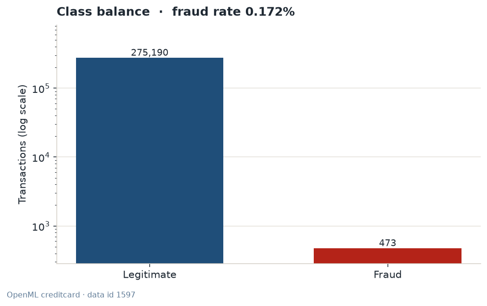
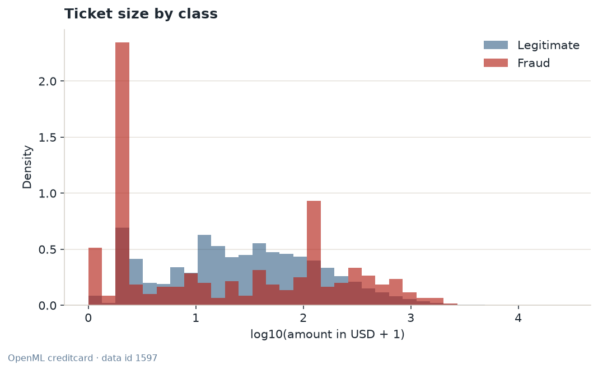
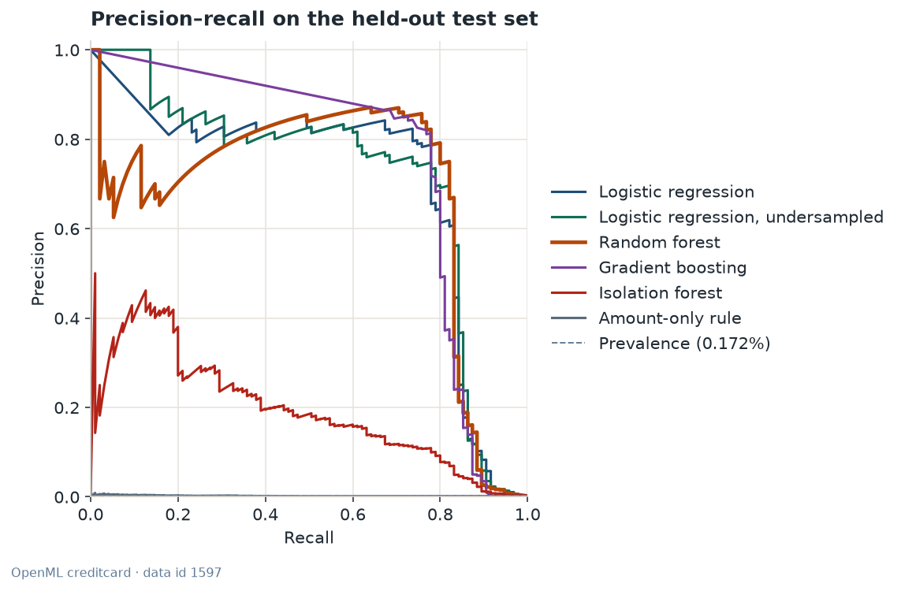
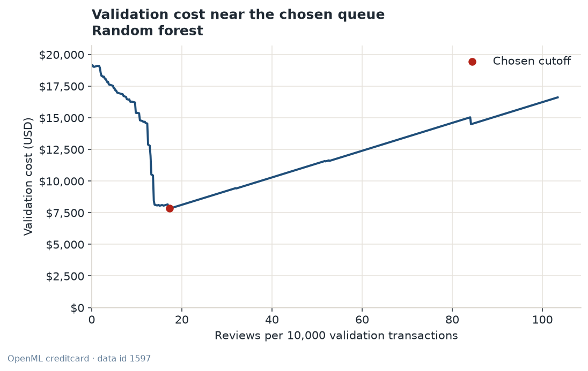
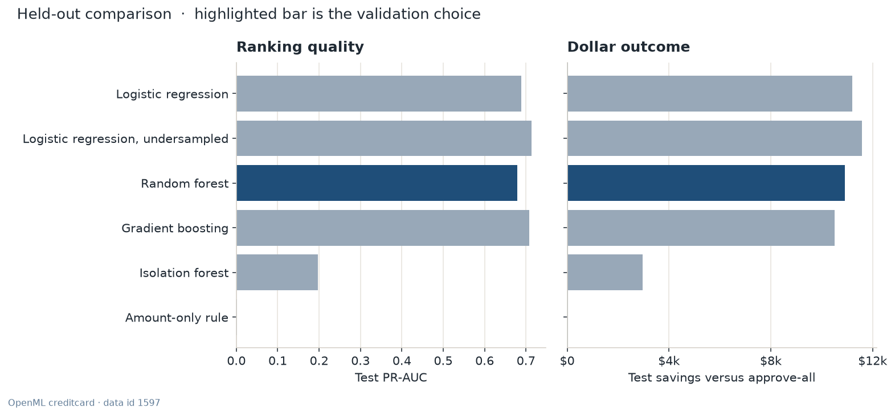
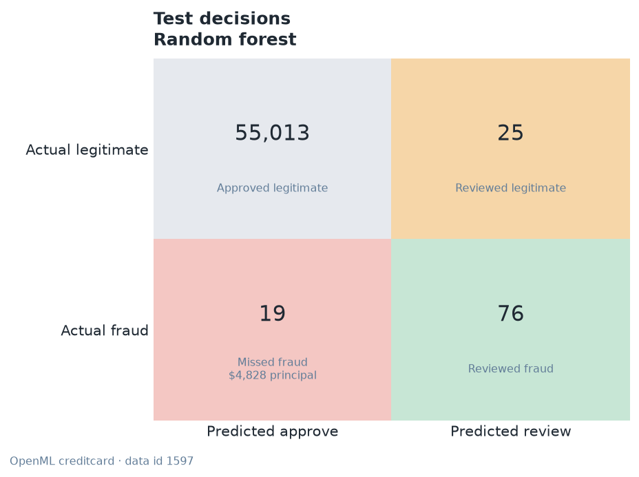
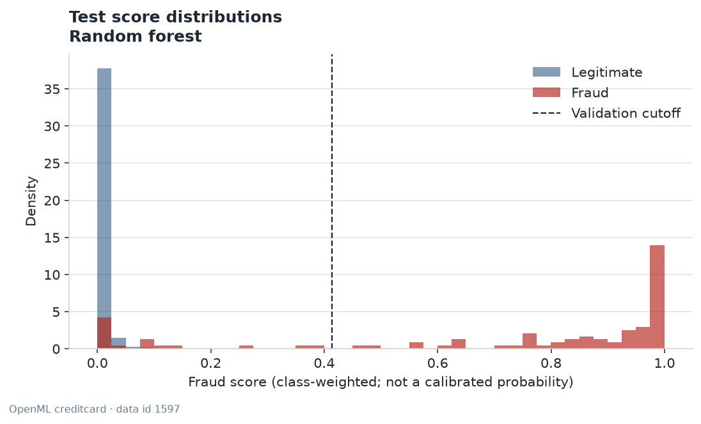

# Credit-card fraud review lab

Portfolio project for **Ladarius Jackson**, Business Analytics.

A card issuer does not need a model that is “accurate.” After exact duplicates are removed, this book is 275,190 legitimate transactions and 473 frauds. Approving every transaction is already 99.83% accurate, and it still pays every fraud. This project decides which tickets to pull into a manual review queue, and it scores that decision in dollars.

The numbers below are from the public **OpenML creditcard · data id 1597** file. They are not from the synthetic fallback.

## The decision, in one page

Approving every held-out transaction costs **$17,315**. The selection rule was locked before looking at the test set: pick the model with the lowest **validation** dollar cost, and break ties with validation PR-AUC. That rule selects a **random forest**. At the cutoff chosen on validation (score ≥ 0.413574), the forest costs **$6,411** on the test set and saves **$10,903** against approve-all. The 95% bootstrap interval on that test cost is **$2,102–$12,180**. The interval is wide because the test slice has 95 frauds.

On that same test slice, an undersampled logistic regression costs **$5,728** and has a higher PR-AUC (**0.713** vs **0.679**). It was not selected. Switching to it after seeing the test set would make the holdout optimistic. The gap is also small next to the bootstrap interval. What is stable is the gap between the supervised models and the two weak policies: a large-ticket rule, and a class-weighted logistic regression left at a 0.50 cutoff.

| Policy on the test set | Cost | What it does |
| --- | ---: | --- |
| Approve everything | $17,315 | Pays every fraud plus the $25 chargeback fee |
| Random forest, validation cutoff | $6,411 | Selected model. 76 of 95 frauds reviewed, 25 legitimate tickets pulled |
| Random forest at 0.50 | $6,287 | Close to the tuned cutoff on this split; not used for selection |
| Logistic regression, class-weighted, at 0.50 | $26,933 | Worse than doing nothing |
| Same logistic regression, validation cutoff | $6,105 | The ranking was fine. The default cutoff was not |
| Amount-only rule | $17,315 | Best validation policy is to approve everything |

PR-AUC is average precision. A useless ranking sits near the fraud rate (0.172%). Accuracy is not in this table on purpose.

## Ranking quality

Cutoff-free. Higher is better. The bootstrap interval resamples the test rows and does not retune the model.

| Model | Strategy | Val PR-AUC | Test PR-AUC (95% CI) | Recall at precision ≥ 0.50 | Recall at precision ≥ 0.80 |
| --- | --- | ---: | ---: | ---: | ---: |
| Logistic regression | Class weights (balanced) on every training row | 0.652 | 0.689 (0.592–0.787) | 0.832 | 0.737 |
| Logistic regression, undersampled | Random undersample to 25:1, then unweighted logistic regression | 0.671 | 0.713 (0.625–0.806) | 0.842 | 0.611 |
| **Random forest** | balanced_subsample class weights; 30,000-row bootstrap when training is larger | 0.640 | 0.679 (0.579–0.788) | 0.832 | 0.779 |
| Gradient boosting | HistGradientBoosting with balanced sample weights | 0.675 | 0.708 (0.607–0.799) | 0.800 | 0.779 |
| Isolation forest | Unsupervised; fit on legitimate training rows only, capped at 120,000 | 0.184 | 0.197 (0.141–0.288) | 0.011 | n/a |
| Amount-only rule | Review a ticket when its USD amount is high enough | 0.003 | 0.002 (0.001–0.004) | n/a | n/a |

Recall at a precision target answers a staffing question: if the queue must be at least 50% (or 80%) fraud, how much fraud can you still catch? The supervised models can hold 80% precision and still catch roughly 61–78% of test frauds. The amount rule never reaches those precision targets, because large tickets are usually legitimate.

## Operating point

Each cutoff minimizes validation dollar cost. Among tied cutoffs, the higher score wins, which means a shorter queue. The test set is scored once at that frozen cutoff.

| Model | Cutoff | Precision | Recall | Flag rate | Reviews / 10k | Test cost | Savings vs approve-all |
| --- | ---: | ---: | ---: | ---: | ---: | ---: | ---: |
| Logistic regression | 0.999979 | 0.789 | 0.747 | 0.2% | 16.3 | $6,105 | $11,210 |
| Logistic regression, undersampled | 0.697979 | 0.721 | 0.789 | 0.2% | 18.9 | $5,728 | $11,586 |
| **Random forest** | 0.413574 | 0.752 | 0.800 | 0.2% | 18.3 | $6,411 | $10,903 |
| Gradient boosting | 0.679541 | 0.714 | 0.789 | 0.2% | 19.0 | $6,801 | $10,514 |
| Isolation forest | 0.005803 | 0.132 | 0.674 | 0.9% | 88.0 | $14,346 | $2,968 |
| Amount-only rule | approve all | n/a | 0.000 | 0.0% | 0.0 | $17,315 | $0 |

The class-weighted logistic cutoff is 0.999979, not 0.50. Class weights move probability mass upward. A score of 0.50 is not “50% chance of fraud,” and it is not a business decision.

Validation costs, which are what the selection rule saw: random forest $7,856, class-weighted logistic $7,899, gradient boosting $8,336, undersampled logistic $8,421, isolation forest $15,770, amount rule $19,165. The forest won validation by a few hundred dollars. The test set ranked the undersampled logistic first. `reports/metrics.json` records both, including `selection_matches_test_leader: false`.

### Where the forest’s $6,411 goes

On 55,133 test transactions (95 frauds):

| Piece | Count | Dollars |
| --- | ---: | ---: |
| Missed fraud principal | 19 frauds | $4,828 |
| Chargeback fee on those misses | 19 × $25 | $475 |
| Analyst time on caught fraud | 76 × $8 | $608 |
| Review plus false-decline cost on legitimate tickets | 25 × $20 | $500 |
| **Total** |  | **$6,411** |

Approve-all on the same rows is the $4,828 principal plus fees on all 95 frauds, with no review cost: $17,315. The savings are mostly “don’t pay the frauds you catch,” net of a short queue.

At 4 minutes a review, 101 test reviews are about 6.7 analyst hours. Scaled, the published queue is **18.3 reviews per 10,000 transactions**, or about **1.2 analyst hours per 10,000 transactions**.

## Charts



Fraud is 0.172% of the modeling table. A chart that hides that ratio will make accuracy look like a result.



Densities, not counts, so 473 frauds are visible next to 275,190 legitimate tickets. Median fraud is **$10.80**. Median legitimate spend is **$26.13**. The largest ticket in the file is legitimate ($28,260). A “review the big tickets” rule is aimed at the wrong place.



The dashed line is the fraud rate. That is the precision of a useless ranker. The amount rule sits on it. The four supervised models stay near each other out to about 80% recall.



Cost falls from the approve-all point (about $19,165 on validation) to about $7,856 near 17 reviews per 10,000, then climbs as legitimate tickets fill the queue. The axis stops at 100 reviews per 10,000. Flagging everyone would cost on the order of a million dollars in false-decline and review fees and would hide this dip.



The dark bar is the random forest because validation cost selected it. The undersampled logistic regression saves slightly more on the test set. The amount rule saves nothing, so it has no bar.





These scores are for ranking. They are not calibrated probabilities. The review desk therefore tunes a queue size, not a “probability of fraud” slider.

## Business takeaways

1. **Staff a short queue, do not chase a 0.50 probability.** The useful supervised policies all land near 16–19 reviews per 10,000 transactions, with precision around 0.71–0.79 and recall around 0.75–0.80. That is a review desk, not a decline-everything rule.

2. **Class weights without a cutoff search lose money.** Balanced logistic regression at 0.50 costs $26,933 on the test set, about $9,600 worse than approving everything. The same scores, cut at 0.999979, cost $6,105. Imbalance handling is not finished until the threshold is chosen on dollars.

3. **Undersampling is a training trick, not an evaluation trick.** The undersampled logistic model saw 7,358 training rows (every training fraud, plus 25 legitimate rows each). Validation and test stayed at the natural 0.172% fraud rate. Its test PR-AUC is the best in the set. It still lost the precommitted validation-cost rule by a few hundred dollars.

4. **Do not deploy “review large tickets” as the control.** Median fraud is smaller than median legitimate spend. Under these review costs, the amount rule’s best validation decision is to approve everything. Its test PR-AUC is 0.002.

5. **An unsupervised model is the late-label baseline, not the desk.** The isolation forest never saw a fraud label in training. It still saves $2,968 against approve-all, with precision of only 0.132. If labels exist, the supervised models are worth the difference.

6. **Do not narrate V1–V28.** They are principal components from the public extract. This lab does not know which original fields they came from. OpenML data id 1597 also has no `Time` column, so this run does not use hour of day. Inventing a story for “V14” would be a false briefing.

7. **One split is not a model championship.** Ninety-five test frauds make a $1,000 gap between forest and logistic regression look decisive and mean very little. The bootstrap range on the forest’s test cost runs from about $2,100 to about $12,200. Report the protocol, the interval, and the fact that the test-cost leader is not the selected model.

## How a ticket is costed

Every transaction is either approved or sent to review. This is a loss account, not a profit model. Interchange income is not credited.

| Outcome | Cost |
| --- | --- |
| Approve a legitimate ticket | $0 |
| Approve a fraud | Ticket amount + $25 chargeback fee |
| Review a fraud | $8 analyst time. The principal is treated as saved |
| Review a legitimate ticket | $8 analyst time + $12 false-decline cost |

The $8 review is 4 minutes at $120 an hour. The $12 false-decline cost is a planning penalty for pulling a good customer, not a measured interchange loss. The $25 fee is an operations assumption on top of the principal. All three are inputs on the review desk and flags on the training command. They are not estimated from the file.

Public amounts are euros. This case study converts them at **1.10 USD per EUR** before any model is fit. That is a round planning rate, not a reconstructed 2013 spot rate. Synthetic runs, if the public file cannot be verified, are generated directly in USD and are labeled as such. These published results used the public file, so the rate applies.

The cutoff rule is `score >= threshold`. If no threshold beats approving everyone, the policy approves everyone. That is what happened to the amount rule.

## Data

| Item | Value |
| --- | --- |
| Source | OpenML `creditcard`, data id 1597, version 1, licence Public |
| Fingerprint, before any cleaning | 284,807 rows, 492 frauds |
| Exact duplicate rows removed | 9,144 |
| Modeling table | 275,663 rows, 473 frauds (0.1716%) |
| Columns used | V1–V28 and Amount. `Time` is not in this file |
| Amount unit in the model | USD, after × 1.10 |
| Split, seed 42 | Train 165,397 (283 frauds), validation 55,133 (95), test 55,133 (95) |

Duplicates are dropped only after the fingerprint matches, so a copied ticket cannot land in both train and test and inflate the score. The fraud count falls from 492 to 473 because some fraud rows were copies.

The loader is `python -m fraudlab --source auto`. It checks the OpenML name, id, row count, and fraud count. If the download fails or the fingerprint does not match, training does not continue on a half-parsed table. The run switches to `fraudlab.synthetic`, writes `SYNTHETIC FALLBACK` at the top of `reports/DATA_SOURCE.txt`, and prints that label on every chart. The generator is original: a handful of components are shifted for the fraud class, amounts mix small card-testing tickets with a heavier tail, and the default fraud rate matches 492/284,807. It does not copy public rows. **This README’s tables are from the verified public extract.**

Citation: Dal Pozzolo, A., Caelen, O., Johnson, R. A., and Bontempi, G. (2015). Calibrating probability with undersampling for unbalanced classification. In *2015 IEEE Symposium Series on Computational Intelligence*. Dataset mirror: [OpenML data id 1597](https://www.openml.org/d/1597).

## What was fit

| Model | Imbalance handling | Fit rows |
| --- | --- | ---: |
| Logistic regression | `class_weight="balanced"`, C=1, lbfgs, 1,000 iterations | 165,397 |
| Logistic regression, undersampled | 25 legitimate rows per fraud, then unweighted logistic regression | 7,358 |
| Random forest | `balanced_subsample`, 100 trees, depth 12, `min_samples_leaf=25`, 30,000-row bootstrap | 165,397 |
| Gradient boosting | `HistGradientBoostingClassifier`, learning rate 0.08, 200 iterations, 31 leaves, balanced sample weights | 165,397 |
| Isolation forest | 200 trees, `max_samples=8,192`, fit on 120,000 legitimate training rows only. Score is the flipped `decision_function` | 120,000 |
| Amount-only rule | Score equals the USD amount. Nothing is fit | 0 |

Amount is `log1p`-scaled with a `StandardScaler` fit on the training fold only. V1–V28 are passed through. The recorded runtime for this scorecard was 36 seconds (Python 3.12, scikit-learn 1.9.1, 4 cores). A laptop will differ. Bootstrap used 400 resamples of the test set at the frozen cutoff.

## How to run

```bash
python -m venv .venv
source .venv/bin/activate
pip install -r requirements.txt
python -m fraudlab --source auto
pytest
ruff check .
ruff format --check .
streamlit run app/streamlit_app.py
```

`make train`, `make test`, `make lint`, and `make dashboard` call the same commands.

Useful flags:

```bash
python -m fraudlab --source auto --usd-per-eur 1.10 --review-cost 8 --false-decline-cost 12 --chargeback-fee 25
python -m fraudlab --source synthetic --synthetic-rows 4000 --fraud-rate 0.02 --fast
```

`--source openml` refuses to fall back. `--source synthetic` never contacts OpenML. `--fast` shrinks the trees for a smoke run; the published scorecard was not a fast run.

Outputs:

| Path | What it is |
| --- | --- |
| `reports/metrics.json` | Full scorecard, including the model that was not selected |
| `reports/results.md` | Generated tables. Do not hand-edit |
| `reports/DATA_SOURCE.txt` | `OPENML CREDITCARD` or `SYNTHETIC FALLBACK` |
| `reports/figures/` | The seven charts above |
| `artifacts/selected_model.joblib` | The validation-chosen pipeline |
| `artifacts/validation_scores.npz` | Validation labels, scores, and amounts, so the desk can retune the queue without refitting |
| `artifacts/demo_transactions.csv` | Held-out examples. Labels are in the file so the desk can reveal them |

Joblib will execute code on load. Load only a model you produced locally.

## Review desk

`streamlit run app/streamlit_app.py` opens three tabs.

**Queue cutoff.** Edit the three dollar assumptions. The chart replays the validation set. “Use cost-minimizing queue” jumps the slider to the cutoff those assumptions imply. The four headline metrics at the top of the page stay the published test result. Dragging the slider does not rewrite them.

**Score a transaction.** Score a held-out example, or a training-fold median profile, and change the amount. The page shows the four possible costs for that ticket. It does not multiply the score by the amount and call that an expected loss. Reveal the held-out label when you want the realized cost of the call you just made. V1–V28 can be edited; they still do not have business names.

**Model comparison.** The held-out table and the charts. The test-cost leader is named even when it is not the deployed model.

If `artifacts/` is missing, the page tells you to run `python -m fraudlab --source auto`.

## Tests and CI

GitHub Actions (`.github/workflows/ci.yml`) installs `requirements.txt` on Python 3.12 and runs `ruff check`, `ruff format --check`, and `pytest`. Coverage is measured on `fraudlab` and fails under 85%. The suite uses the synthetic generator, including a forced OpenML failure, so CI does not download the public file and does not need a network. The current local run of that suite is above the floor.

## What this is not

This is a case study, not a production fraud system. The public extract is two days of European card traffic, already reduced to principal components, from a study published in 2015. Costs and the 1.10 FX rate are planning assumptions. There is one stratified split, not a drift monitor, not a challenger/champion rollout, and not a customer-level loss model. A review is assumed to save the full principal. Partial recovery, friendly fraud, and analyst capacity limits beyond the per-ticket fee are out of scope.

Re-fit before you brief anyone on a new book. Do not brief V1–V28 as if they were merchant categories.
